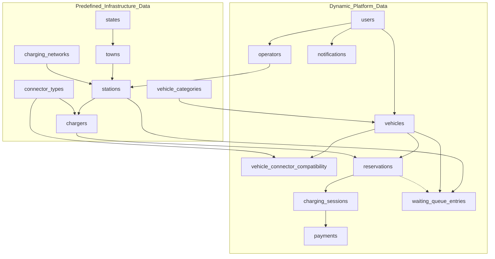

# Database Overview: EV Charging Station Network Orchestrator

## 1. Project Background

The **EV Charging Station Network Orchestrator Database** is an enterprise-grade relational database architecture implemented on **PostgreSQL 14+**. It is designed to orchestrate large-scale electric vehicle (EV) charging infrastructure across metropolitan and rural grids, managing real-time bay availability, transaction-safe bookings, waiting queue dispatching, actual power delivery sessions, and billing snapshots.

The database is built on:
- Primary specification: **Revised V3 Database Design (3NF)**
- Integrated master data: **15,027 authentic EV infrastructure records** from Karnataka, India
- High-concurrency transaction safety: PostgreSQL exclusion constraints (`btree_gist`), row locking (`SELECT FOR UPDATE`), and ACID guarantees.

---

## 2. Technology Stack

- **RDBMS Engine**: PostgreSQL 14 / 15 / 16
- **Database Administration**: pgAdmin 4 / psql CLI
- **SQL Extensions**:
  - `btree_gist`: Enables Generalized Search Tree indexing for scalar datatypes (required to build GiST exclusion constraints on `(charger_id, tstzrange(slot_start, slot_end))` for concurrency safety).
  - `pgcrypto`: Standard cryptographic primitives for hashing user passwords securely.
  - `uuid-ossp`: UUID generation support.

Database Name: `ev_charging_orchestrator`

---

## 3. Entity Classification (16 Entities)

The 16 tables are logically partitioned into **Predefined Master Data Tables** (populated directly from the 15,027 CSV records) and **Operational Dynamic Tables** (handling platform activity):

### 3.1 Predefined Infrastructure Master Tables (7 Tables)
1. **`states`**: Master registry of states and territories. Contains state ID and unique name.
2. **`towns`**: Municipal jurisdictions mapped to their parent state via `state_id`.
3. **`charging_networks`**: Commercial and governmental operators (e.g., BESCOM, Ather, BPCL).
4. **`vehicle_categories`**: Classification codes (`EM`, `4W`, `3W`, `2W`, `HV`) with integer `queue_rank` for priority dispatch.
5. **`connector_types`**: Hardware standards (`CCS2`, `CHADEMO`, `TYPE2_AC`, `BHARAT_AC001`, `BHARAT_DC001`, `LEV_AC`, `LEV_DC`) and electrical mode (`AC` vs. `DC`).
6. **`stations`**: Physical charging sites with precise GPS coordinates, address, and network affiliation.
7. **`chargers`**: Individual bays/ports at stations with power ratings (`power_kw`) and connector standards.

### 3.2 Operational Dynamic Tables (9 Tables)
8. **`users`**: Platform user accounts with role-based access (`USER`, `OPERATOR`, `ADMIN`).
9. **`operators`**: Operator assignment linking a user to exactly one station (enforced via `1:1` UNIQUE constraint).
10. **`vehicles`**: EVs registered by users with battery capacities and category classification.
11. **`vehicle_connector_compatibility`**: M:N junction table mapping which connector standards each vehicle accepts.
12. **`reservations`**: Scheduled time slots booked by vehicle owners on specific chargers.
13. **`waiting_queue_entries`**: Dynamic queue for over-subscribed stations, with priority determined by vehicle category rank.
14. **`charging_sessions`**: Actual physical energy delivery telemetry linked 1:1 to a reservation.
15. **`payments`**: Immutable financial ledger capturing billing snapshots upon session completion.
16. **`notifications`**: User alert history for bookings, session milestones, and queue status changes.

---

## 4. Key Architectural Highlights

1. **Strict 3NF Compliance**: Eliminates all transitive dependencies and derived redundancy. Calculated attributes (session cost, queue priority rank, connector-station linkages) are computed dynamically through views (`v_charging_session_cost`, `v_queue_priority`, `v_charger_connector`).
2. **Deterministic Concurrency Guard**: Excludes double bookings at the PostgreSQL engine level using exclusion constraints. No conflicting active or confirmed reservations can exist on the same charger for overlapping time intervals.
3. **Dual Table Name Compatibility**: Full support for both plural (`stations`, `chargers`) and singular (`station`, `charger`) naming through transparent SQL synonym views.

